# options-lab: results

**Data.** The SPY option chain snapshot is from the close of **2026-10-09** and was downloaded on 2026-10-12. Spot was $778.57, and the 13-week T-bill rate was 4.06% discount (4.13% continuously compounded). SPY, ^VIX and ^IRX daily history covers 2006-01-03 to 2025-12-31 and was downloaded on 2026-10-12. All files are cached in `data/`. Random seeds are fixed, and running `python scripts/run_all.py` reproduces every number below. The exception is wall-clock timings, which vary from run to run.

## Plain-English summary

* **The three pricing methods agree.** The binomial tree and Monte Carlo reproduce Black-Scholes. The tree is within a tenth of a cent, and Monte Carlo is within two standard errors.
* **Variance reduction depends on finding the right control.** Antithetic sampling roughly halves the variance. Using the geometric Asian as a control cuts the variance of the arithmetic Asian by about **1,400×**. A vanilla call is a poor control for the barrier option (about 1.04×), because the vanilla pays the most exactly when the barrier option pays nothing.
* **The SPY smile is a steep put skew.** Implied vol is highest for low strikes. The ATM term structure slopes upward, from 8.5% at 5 days to 17.8% at 1.7 years.
* **In simulation, delta hedging works the way theory says.** When implied vol equals realised vol, hedged P&L averages zero. When they differ, it tracks the gamma-weighted gap between implied and realised variance (correlation 0.97). Hedging error shrinks roughly like 1/√(number of hedges).
* **In history, implied vol was usually too high.** From 2007 to 2025, VIX exceeded the realised 30-day vol that followed by **3.6 vol points on average**, in 83% of months. A delta-hedged short ATM call priced at VIX earned **+0.39% of spot per month** with a **79% hit rate**. Its losses came in rare, sharp crises: March 2020, April 2025, and autumn 2008.
* **The caveat that matters most.** VIX is not SPY ATM implied vol. On the snapshot date it was 2.8 points higher. If the true ATM vol was 3 points below VIX, the hedged-call profit falls to a statistically insignificant 0.06% per month. The variance risk premium itself (VIX vs realised) is robust. How much of it an ATM option seller actually captures is uncertain in this data.

---

## Part 1: Pricing engine

Parameters: S = 100, T = 1, r = 5%, σ = 20%, q = 1.5%.

### Three methods, one price

| Option | Strike | Black-Scholes | CRR (N=2000) | Monte Carlo (1M paths, antithetic + control) | MC std error | MC z-score |
|---|---|---|---|---|---|---|
| call | 80 | 23.21415 | 23.21380 | 23.21408 | 0.00082 | −0.08 |
| call | 100 | 9.52354 | 9.52256 | 9.52319 | 0.00284 | −0.12 |
| call | 120 | 2.83861 | 2.83899 | 2.83634 | 0.00117 | −1.94 |
| put | 80 | 0.80131 | 0.80096 | 0.80124 | 0.00082 | −0.08 |
| put | 100 | 6.13529 | 6.13431 | 6.13494 | 0.00284 | −0.12 |
| put | 120 | 18.47495 | 18.47532 | 18.47267 | 0.00117 | −1.94 |

The call and put z-scores are identical by construction. With the stock as a control variate, the call payoff minus the put payoff equals S_T − K, which is exactly the control. Put-call parity therefore holds path by path inside the estimator.

### Binomial convergence

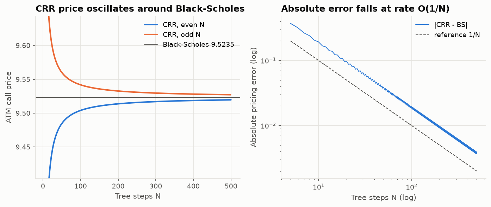

The CRR price oscillates around Black-Scholes. Even N comes out below and odd N above. The absolute error falls at rate O(1/N): it is −0.0039 at N = 500 and +0.0037 at N = 499.

### Early-exercise premium of the American put

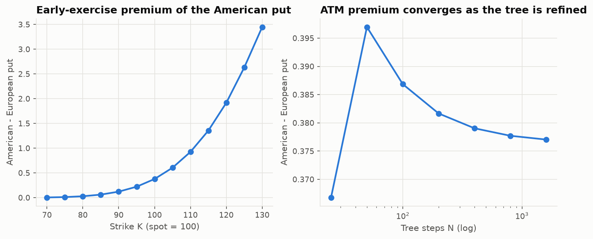

| Strike | 70 | 80 | 90 | 100 | 110 | 120 | 130 |
|---|---|---|---|---|---|---|---|
| American − European | 0.004 | 0.028 | 0.121 | 0.377 | 0.925 | 1.918 | 3.448 |

The premium grows with moneyness. At K = 130 the American put is worth exactly its intrinsic value of 30.00, which means immediate exercise is optimal. The ATM premium converges from 0.367 (N = 25) to 0.377 (N = 1600). For an American call on a non-dividend stock, the tree's early-exercise premium is zero, as Merton (1973) proves. This is tested.

### Monte Carlo variance reduction (200,000 paths, 252 fixings or monitoring dates)

| Product | Method | Price | Std error | Variance reduction | Reference |
|---|---|---|---|---|---|
| European call | plain | 9.4903 | 0.03145 | 1.0× | BS 9.5235 |
| | antithetic | 9.5241 | 0.02322 | 1.8× | |
| | control (stock) | 9.5244 | 0.01271 | 6.1× | |
| | antithetic + control | 9.5115 | 0.00636 | 24.5× | |
| Arithmetic Asian call | plain | 5.3200 | 0.01719 | 1.0× | no closed form |
| | antithetic | 5.3224 | 0.01240 | 1.9× | |
| | control (geometric Asian) | 5.3373 | 0.00046 | **1,385×** | |
| | antithetic + control | 5.3375 | 0.00048 | 1,306× | |
| Up-and-out call, H = 130 | plain | 3.3891 | 0.01390 | 1.0× | BGK approx. 3.4074 |
| | antithetic | 3.3928 | 0.01165 | 1.4× | |
| | control (vanilla call) | 3.3906 | 0.01361 | 1.04× | |
| | antithetic + control | 3.3888 | 0.01124 | 1.5× | |

How to read the table:
* **Same paths, different estimators.** Every estimator agrees with its reference within about 2 standard errors. For example, the plain European estimate is 1.06 SE below BS.
* **The geometric control is very strong for the Asian.** The arithmetic and geometric averages of the same path are almost perfectly correlated, so the remaining variance is tiny. Adding antithetic on top gives no further gain: 1,306× versus 1,385× is within sampling noise.
* **The vanilla control is weak for the barrier.** Its payoff is largest on high-S_T paths, which are exactly the paths that knocked out. The low correlation is reported here as measured, and the control was not changed to improve the table.
* **The barrier price is plausible.** It sits between the continuous-barrier closed form (3.24, which knocks out more often) and the BGK-corrected value.

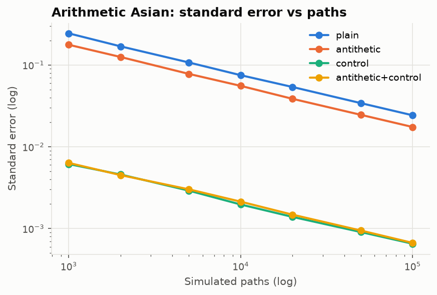

Every method's standard error falls like 1/√n. Variance reduction lowers the level of the line, not its slope.

### Runtime benchmarks (best of 3, Apple Silicon, Python 3.12)

| Task | Vectorised | Naive Python loop | Speed-up |
|---|---|---|---|
| Black-Scholes, 100k strikes | 2.3 ms | 42 ms | ~18× |
| CRR American put, N = 2000 | 37 ms | 753 ms | ~20× |
| Asian MC, 20k paths × 252 steps | 65 ms | 895 ms | ~14× |

The speed-ups are modest because the naive versions use fast `math` scalar functions. The numbers are reported as measured.

---

## Part 2: Implied volatility (SPY, quotes at close 2026-10-09)

### Cleaning funnel

| Filter | Rows left |
|---|---|
| raw rows (30 expiries) | 9,770 |
| 5 ≤ days to expiry ≤ 760 | 8,537 |
| bid > 0 and ask > bid | 7,393 |
| relative spread ≤ 25% | 7,065 |
| mid ≥ $0.05 | 7,017 |
| volume ≥ 10 | 2,885 |
| open interest ≥ 100 | 2,467 |
| out-of-the-money side only | 1,994 |
| no vertical-spread arbitrage across strikes | 1,991 |
| implied vol solved | **1,991** (all solved by Newton, across 23 expiries) |

The static-arbitrage filter removed three quotes, all with last trades in May to July 2026. One was the March 2027 602 put, quoted at $10.55 between the 600 put at $3.98 and the 605 put at $4.16. Those are stale quotes that a volume filter alone did not catch. Removed quotes are listed in `results/iv_dropped_arbitrage_quotes.csv`. The median absolute difference between my IVs and Yahoo's own `impliedVolatility` field is 1.2 vol points.

### Volatility smile

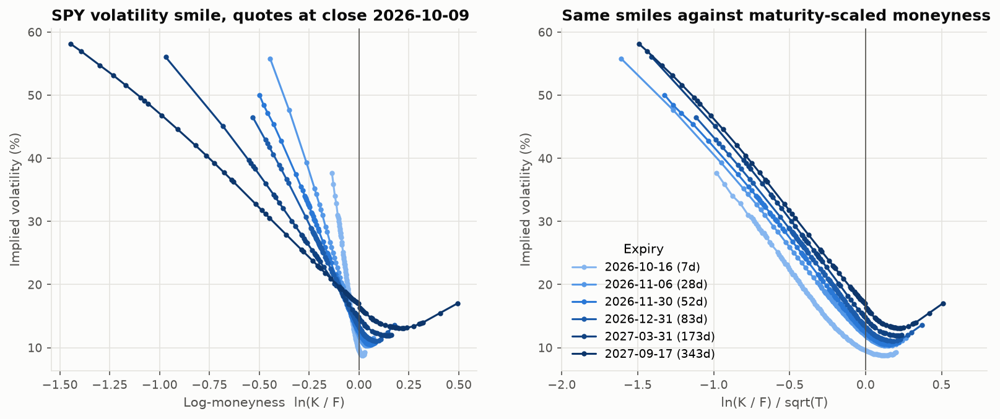

* **Left panel.** The smile is a pronounced put skew: OTM puts carry much higher implied vol than OTM calls. Short maturities have the steepest skew in raw log-moneyness.
* **Right panel.** Rescaling moneyness by √T makes the skews nearly parallel. In raw k, skew flattens roughly like 1/√T as maturity grows.

### ATM term structure

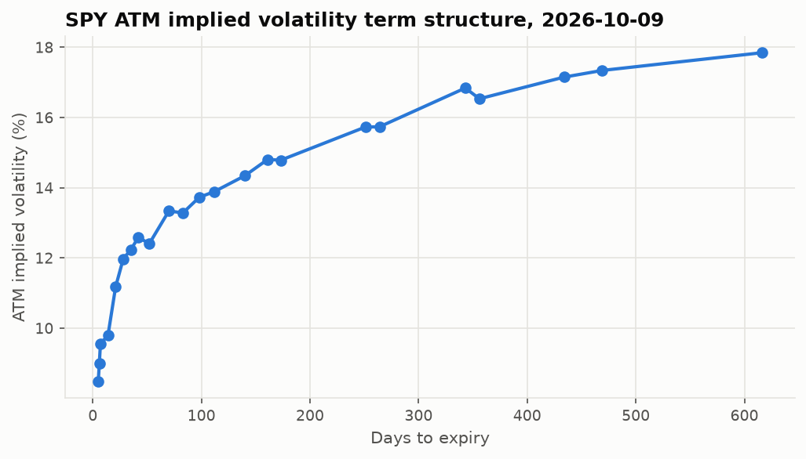

ATM IV rises from 8.5% (5 days) through 12.0% (28 days) and 14.8% (6 months) to 17.8% (616 days). This upward slope (contango) is typical of a calm market. The interpolated 30-day ATM IV is **12.05%**, while VIX closed at **14.84** the same day. That gap matters for Part 3.

---

## Part 3.1: Delta-hedging simulation (GBM)

The position is a short 30-day ATM call with S = K = 100, σ_implied = 20%, r = 4%, μ = 8%. The premium is $2.45. Results use 20,000 paths.

### Rebalancing frequency and costs (implied = realised = 20%)

| Rebalancing | Costs | Mean P&L | Std | t-stat | 5% quantile | Mean cost |
|---|---|---|---|---|---|---|
| daily (21 hedges) | none | +0.004 | 0.425 | 1.33 | −0.70 | — |
| weekly (5) | none | +0.002 | 0.867 | 0.38 | −1.50 | — |
| none (static Δ₀) | none | −0.020 | 1.746 | −1.63 | −3.38 | — |
| daily | 2 bps | −0.046 | 0.427 | −15.3 | −0.76 | 0.050 |
| weekly | 2 bps | −0.033 | 0.869 | −5.4 | −1.53 | 0.035 |
| none | 2 bps | −0.042 | 1.746 | −3.4 | −3.40 | 0.021 |
| *unhedged (reference)* | none | −0.178 | 3.726 | −6.8 | −8.01 | — |

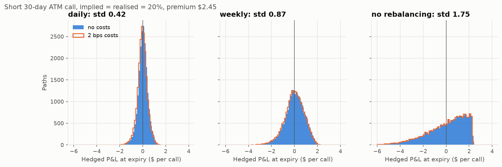

* **Daily hedging with no costs is centred on zero.** The mean of +$0.004 has a t-stat of 1.33, so it is statistically indistinguishable from zero.
* **Variance grows as hedging becomes less frequent.** The std doubles from daily to weekly and doubles again with no rebalancing.
* **Costs create a trade-off.** More frequent hedging lowers variance but costs more: $0.050 for daily versus $0.035 for weekly at 2 bps.

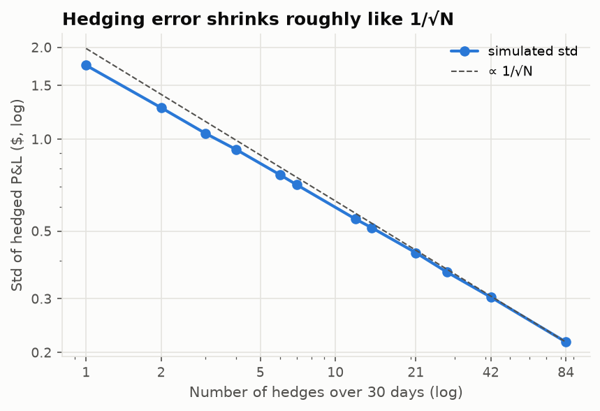

Std falls roughly like 1/√N. Going from 21 to 84 hedges halves it, from 0.425 to 0.216. At very low N the curve bends slightly, because 1/√N is an asymptotic result.

### P&L tracks ½ Γ S² (σ_implied² − σ_realised²) dt

| Realised vol | Mean P&L | Gamma-theta prediction | Corr(actual, approx) | Regression slope |
|---|---|---|---|---|
| 15% | +0.572 | +0.569 | 0.974 | 1.06 |
| 20% | +0.004 | +0.004 | 0.972 | 0.99 |
| 25% | −0.566 | −0.570 | 0.964 | 0.97 |

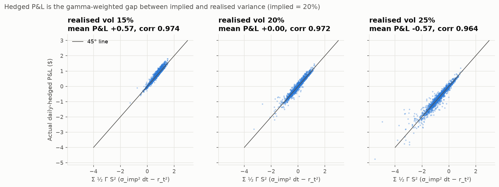

Selling at 20% vol when 15% is realised earns about $0.57 per call. When 25% is realised, it loses about the same amount.

A side check is in `tests/test_hedging_sim.py`. Under the risk-neutral drift (μ = r), the mean is zero even with no rebalancing, because the discounted option price is a martingale. Under μ = 8%, the *unhedged* short call loses $0.18 on average (t = −6.8, last row of the frequency table), because the stock tends to rise against the seller. The hedged versions do not show this loss, because hedging removes the drift exposure.

---

## Part 3.2: Historical variance risk premium (SPY, 2007–2025)

The trades are 228 monthly short 30-day ATM SPY calls, priced at VIX and delta-hedged daily on actual SPY closes.

### Headline statistics

| Statistic | Value |
|---|---|
| Mean VIX at entry / mean subsequent realised vol | 19.93 / 16.35 |
| **Mean VIX − realised vol (VRP)** | **+3.58 vol pts** (median +4.51, t = 6.0) |
| Months with VIX > realised | 83% |
| Mean VIX² − realised² | +0.0069 (variance units) |
| **Mean hedged P&L** | **+0.39% of spot per month** (median +0.39%, t = 8.4) |
| Std of monthly P&L | 0.71% |
| **Hit rate** | **79%** |
| Skewness / excess kurtosis | −0.14 / 6.9 |
| Best / worst month | +4.41% (Dec 2008) / −2.80% (Mar 2020) |
| Cumulative P&L (sum) / max drawdown | +89.7% / −4.6% of notional |
| Corr(actual P&L, gamma-theta approximation) | 0.96 |
| Lag-1 autocorrelation of monthly P&L | 0.04 |
| With 2 bps costs on stock trades | +0.35%/month, hit rate 77%, cumulative +78.9% |

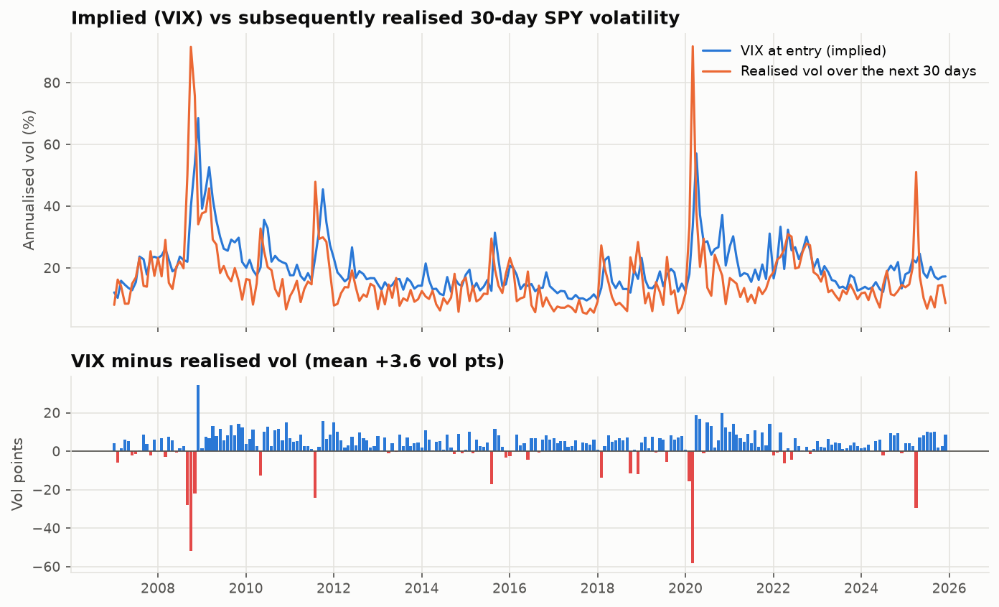

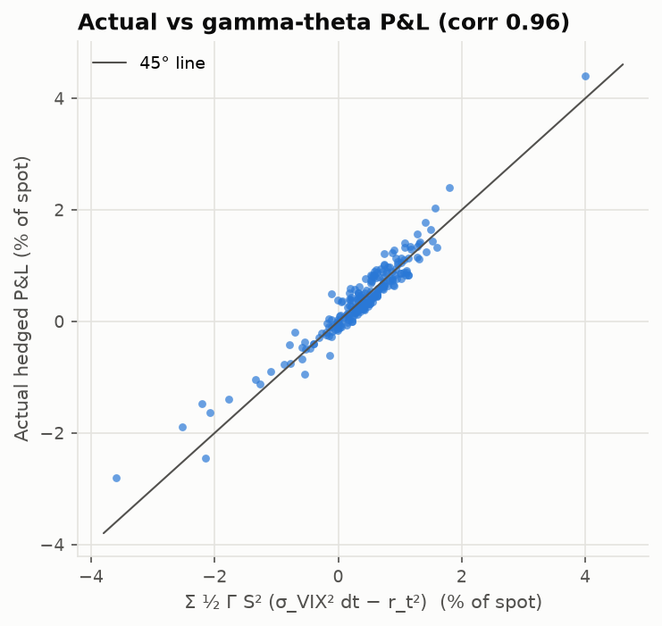

The gamma-theta formula from Part 3.1 explains the real-data P&L well (correlation 0.96). The largest misses are crash months, where daily moves are too big for a second-order approximation.

### Distribution of monthly hedged P&L

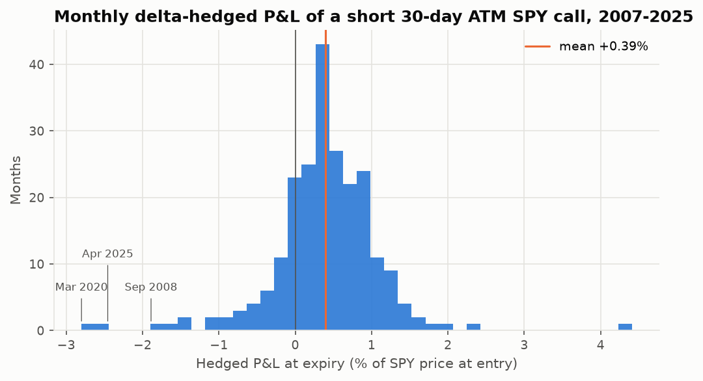

### Worst months

| Entry | VIX | Realised vol | SPY return | Hedged P&L (% spot) |
|---|---|---|---|---|
| 2020-03-02 | 33.4 | 91.8 | −20.4% | **−2.80** |
| 2025-04-01 | 21.8 | 51.1 | −0.4% | **−2.46** |
| 2008-09-02 | 22.0 | 50.1 | −12.6% | **−1.89** |
| 2008-11-03 | 53.7 | 75.7 | −10.1% | −1.64 |
| 2007-02-01 | 10.3 | 16.2 | −4.1% | −1.48 |
| 2011-08-01 | 23.7 | 47.9 | −5.1% | −1.40 |
| 2008-10-01 | 39.8 | 91.6 | −16.6% | −1.11 |
| 2018-02-01 | 13.5 | 27.3 | −4.4% | −1.05 |

As expected, **2008 and 2020 stand out**, and the April 2025 tariff shock joins them. Two details are worth explaining:
* **October 2008 lost less than you might expect.** It had the highest realised vol in the sample (91.6%) but lost only 1.1%. SPY fell 16.6% early in the month, which pushed the call far out of the money, where gamma (and so the cost of realised variance) is small. P&L weights variance by ½ΓS², so the path matters as well as the total.
* **The best month also came from the crisis.** December 2008 earned +4.4%, because VIX had overshot to 68.5 while realised vol came in at 34. 2008 as a whole finished slightly positive (+2.0%).

### Cumulative P&L

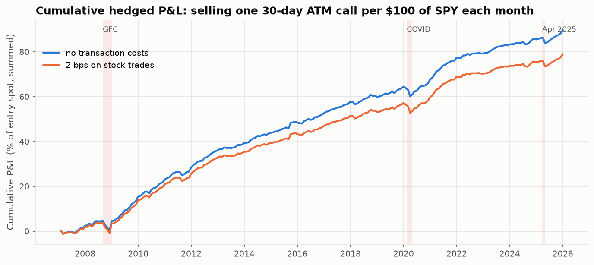

### Sensitivity to the VIX proxy

The option is priced and hedged at VIX + shift, holding everything else fixed.

| Implied vol used | Mean P&L (% spot / month) | t-stat | Hit rate | Cumulative |
|---|---|---|---|---|
| VIX | 0.393 | 8.36 | 79% | 89.7% |
| VIX − 1 | 0.282 | 6.07 | 74% | 64.4% |
| VIX − 2 | 0.172 | 3.72 | 68% | 39.2% |
| VIX − 3 | 0.061 | 1.33 | 56% | 14.0% |

Each vol point is worth about 0.11% of spot per month. On the snapshot date, VIX exceeded SPY 30-day ATM IV by 2.8 points. That is a single observation, not a historical average.

### What this shows, and what it does not

* **The variance risk premium is large and persistent.** Over 19 years, index implied variance (VIX) exceeded the variance that followed in most months, with an average gap of 3.6 vol points. This is consistent with Carr & Wu (2009). Investors pay a premium to hedge market variance, and the seller is compensated for absorbing losses in crashes.
* **The delta-hedged option seller collects that premium as the gamma-theta mechanism predicts.** Correlation with the approximation is 0.96. The seller wins most months, with occasional sharp losses.
* **The size of the profit for an ATM SPY option seller is not established here.** VIX includes the OTM put skew and is an SPX measure, so pricing an ATM SPY call at VIX probably overstates the premium collected. The mean P&L stays significant at the 5% level (t > 1.96) only if true ATM implied vol was within about 2.7 points of VIX on average. That threshold is interpolated from the sensitivity table. This study also ignores option bid/ask costs. Settling the question needs a historical SPY ATM implied-vol series.

## Tests

`pytest`: 310 passed, 40 skipped. The skipped cases are IV round trips where the option's time value is below 1e-10, so σ cannot be identified in double precision.

| Required property | Test |
|---|---|
| Put-call parity for BS prices | `test_black_scholes.py::test_put_call_parity` |
| Binomial European converges to BS (±0.005 at N = 2000) | `test_binomial.py::test_european_converges_to_bs` |
| MC within 3 SE of BS, all estimators | `test_monte_carlo.py::test_mc_european_within_3se_of_bs` |
| Analytic Greeks = finite differences | `test_black_scholes.py::test_greeks_match_finite_differences` |
| IV round trip | `test_implied_vol.py::test_round_trip` (tolerance = rounding error / vega) |
| American put ≥ European put | `test_binomial.py::test_american_put_never_below_european` |
| Hedged mean P&L ≈ 0 when implied = realised | `test_hedging_sim.py::test_mean_pnl_indistinguishable_from_zero_when_implied_equals_realised` |
| No lookahead in historical study | `test_no_lookahead.py` (truncation and scrambled-future tests; a planted lookahead bug was confirmed to fail both) |
